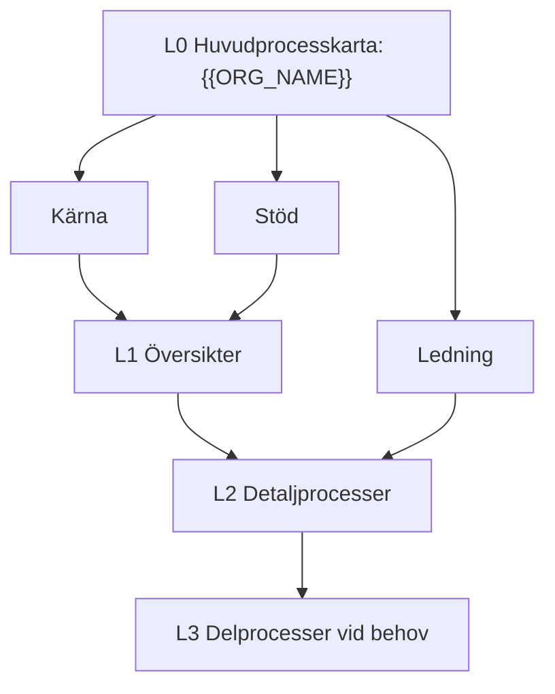

# Mall — skapa visuellt ledningssystem i 2c8 från dokument

> **Läsare:** AI-agent med MCP-servern **ModelM8**, filsystem och shell.  
> **Namn:** **ModelM8** = MCP-verktyget du anropar. **2c8** = Modeling Tool, repon, modeller och metodik (oförändrat). Säg aldrig att modellerna “ligger i ModelM8”.  
> **Ursprung:** Genererad från `TechSeed-IMS/Create-2c8-IMS.md` + lessons learned (`TechSeed-IMS/_2c8-work/SLUTRAPPORT.md`, 2026-11-22) och ModelM8 v1.2+ kvalitet-/skrivverktyg.  
> **Så använder du mallen:** Kopiera till projektmappen (t.ex. `<ORG>-IMS/Create-2c8-IMS.md`), fyll i alla `{{PLACEHOLDERS}}`, ta bort avsnitt som inte gäller, och låt agenten köra planen.

---

## 0. Placeholders (fyll i innan körning)

| Nyckel | Exempel | Värde i detta projekt |
|---|---|---|
| `{{ORG_NAME}}` | TechSeed | |
| `{{REPO_NAME}}` | TechSeed IMS | |
| `{{SOURCE_DIR}}` | `TechSeed-IMS/` | |
| `{{WORK_DIR}}` | `TechSeed-IMS/_2c8-work/` | |
| `{{PROCESS_REGISTER}}` | REG-IMS-002 Process Register | |
| `{{GOVERNANCE_DOC}}` | DIR-IMS Governance & Oversight | |
| `{{PRIMARY_LOCALE}}` | `sv_SE` / Svenska | |
| `{{SECONDARY_LOCALE}}` | `en_GB` / English | |
| `{{PILOT_AREA}}` | Sälja / Sales | |
| `{{DOC_BASE_URL}}` | SharePoint-bas (eller tom) | |
| `{{STANDARDS}}` | ISO 9001, 14001, (27001) | |

---

## 1. Uppdrag

Omvandla `{{ORG_NAME}}`s dokumentbaserade ledningssystem (`{{STANDARDS}}`) till ett **visuellt ledningssystem i 2c8 Modeling Tool**.

Navigering uppifrån och ned:

1. **L0** huvudprocesskarta (ledning / kärna / stöd),
2. **L1** översiktskarta per område (≥2 detaljer),
3. **L2** detaljprocesser (aktiviteter, RACI, BO in/ut, IT, stegspecifika dokument),
4. **L3** vid behov (t.ex. utvecklingsfaser).

**Klart när:**

- Repot `{{REPO_NAME}}` finns och innehåller strukturen.
- Varje process i `{{PROCESS_REGISTER}}` har modell och nås från L0 via nedbrytningar (`get_navigation_tree` utan oväntade `missingUpwardLinks`).
- Varje modell: `review_process_model` OK eller loggat undantag.
- Spårbarhet källa ↔ modell komplett; inget påhittat utan `ANTAGANDE` i `GAPS.md`.
- Handoff-kontrakt verifierat med `verify_handoffs` (samma BO-UUID).
- Översättningar: `list_untranslated_symbols` för sekundärspråket är tomt (eller undantag loggat).
- `verify_process_coverage` mot processregistret: `allPass`.

---

## 2. Parametrar — bekräfta före första skrivning

| Parameter | Standard | Kommentar |
|---|---|---|
| `TARGET_REPO` | Nytt repo **`{{REPO_NAME}}`** | Skapas i fas 2. Skriv aldrig till andra repon. |
| `PRIMARY_LANGUAGE` | `{{PRIMARY_LOCALE}}` (repo-default) | Process-/aktivitets-/BO-titlar. |
| `SECONDARY_LANGUAGE` | `{{SECONDARY_LOCALE}}` | Översätt **i samma batch** som primär när symbol skapas (inte sparad till slut). |
| `ROLE_AND_SYSTEM_NAMES` | Behåll källans namn | Om källan är på annat språk än process-titlar. |
| `UNREGISTERED_PRACTICES` | Modellera + logga i GAPS | Practices utan rad i processregistret. |
| `SCOPE_OPTIONAL_AREAS` | Chevron + dokument | Områden utan certifiering / ofärdigt material. |
| `DOC_BASE_URL` | `{{DOC_BASE_URL}}` | Tom = inga externa länkar. |
| `PILOT_AREA` | `{{PILOT_AREA}}` | Första vertikala snittet. |
| `STOP_AFTER_PILOT` | Ja | Stanna efter G3 / klient-OK. |
| `WORK_DIR` | `{{WORK_DIR}}` | STATE, GAPS, cards, extract, … |

Saknas bekräftelse: **en** samlad fråga. Språk måste vara klara innan `create_repository`.

---

## 3. Regler som alltid gäller

1. **ModelM8**-serverns **instructions** har företräde framför denna plan.
2. **Källtrohet** — hitta inte på; antaganden → `GAPS.md` typ `ANTAGANDE`.
3. **Reuse-first** endast inom målrepot. Aldrig kopiera UUID mellan repon.
4. Ändra aldrig källdokumenten.
5. Inga dubbletter — `find_models` / `search_symbols` före skapande. Misslyckad modell: reparera eller `ZZ_UTGÅR – …` (radering kräver `TWO_C8_ALLOW_DELETES`).
6. Ingen modell klar utan `review_process_model`.
7. **Handoff = samma UUID**, aldrig “liknande titel”.
8. **Vägval ritar valet; aktiviteten gör arbetet.** Mönster: `aktivitet → BO → or → nästa aktivitet`. Aldrig Join/gateway. Anropa `resolve_branching_object_type`.
9. Processövergripande dokument på **processymbolen**, inte fan-out på varje aktivitet.
10. `link_breakdown` **direkt** efter varje icke-rot-modell — vänta inte till slutkontroll.
11. Stanna och fråga vid: obekräftade parametrar, klar pilot, strukturpåverkande motsägelse, samma verktygsfel ×3, destruktiv åtgärd.
12. Uppdatera `STATE.md` när **området stängs**, inte bara i fas 7.

---

## 4. Miljö och verktyg (ModelM8 ≥ 1.2)

Alla verktygsnamn nedan anropas via MCP-servern **ModelM8**. Resultatet skrivs till / läses från **2c8**.

### 4.1 Verifiera vid start

Bekräfta att ModelM8 är ansluten. Kör `list_repositories`, `get_api_versions`; kontrollera skrivläge (`direct`/`draft`), att `create_repository` finns, att `delete_model` saknas om deletes är av.

### 4.2 Verktygskarta (urval)

| Syfte | Verktyg |
|---|---|
| Orientering | `list_repositories`, `list_languages`, `list_description_types`, `list_document_types`, `list_allowed_types` (högst 1×) |
| Metodik | `get_methodology`, `resolve_branching_object_type`, `validate_against_methodology` |
| Konsumera | `find_models`, `describe_process`, `describe_process_map`, `get_detail_process_scope`, `search_symbols`, `find_symbol_usage`, `describe_role` |
| Föreslå/skriv | `propose_model_from_text`, `apply_model_proposal`, `create_process_model`, `create_process_map`, `add_process_step`, `reuse_symbol`, `set_activity_performer`, `set_step_io`, `link_breakdown`, `link_document`, `create_document_type`, `update_titles`, `update_model_description` |
| Rätta layout | `delete_canvas_edge`, `move_canvas_vertices` (auto-reortho), `update_canvas_edges`, `delete_canvas_vertex`, `retarget_vertex_symbol` |
| Kvalitet (v1.2+) | `review_process_model`, `list_untranslated_symbols`, `verify_handoffs`, `get_navigation_tree`, `verify_process_coverage` |

### 4.3 Kända begränsningar

| # | Begränsning | Hantering |
|---|---|---|
| 1 | `review_process_model` antar en horisontell ryggrad | L0 tre band / parallelTracks → godkända undantag (10.3) |
| 2 | `create_process_map` bygger linjära/parallella kedjor, inte fri flerradig karta | Första områdesöversikten **manuell mall**; auto-map bara när scope delar UUID |
| 3 | Nedbrytningar ligger på **detalj** (`broken-down-from`); overview ger ofta tom/404 | Använd `get_navigation_tree`, inte `get_breakdowns(L0)` |
| 4 | Nytt repo kan sakna beskrivnings-/dokumenttyper tills klient öppnats | Smoke-test i fas 2; `create_document_type` vid behov |
| 5 | MT-dokument kräver `type: URL\|file` + länk via `{id, source:"mt.documents"}` | Se `link_document`; testa på en dummy före masslänk |
| 6 | Tom HTTP 200 på PATCH = OK (`{ok:true}`) | Tolka inte som fel |
| 7 | Join nämns ibland i äldre metodiktext | Följ `resolve_branching_object_type` / policy: aldrig Join |
| 8 | EMF/Visio-bilder i källa svåra att Q2:a | Kräv PNG/SVG i extrakt eller konvertera i fas 0 |

Logga ModelM8-/API-avvikelser i `WORK_DIR/MCP-FEEDBACK.md`.

---

## 5. Källmaterial

### 5.1 Inventera

Mappa `{{SOURCE_DIR}}`: dokumenthierarki (policy → direktiv → practice → register → record), ID-format, språk, arkiv vs aktivt.

### 5.2 Processregister

Tabell från `{{PROCESS_REGISTER}}`: kod, titel, kategori (ledning/kärna/stöd), ägare, styrande practice. Detta blir `expected[]` till `verify_process_coverage`.

### 5.3 Styrande dokument

Lista policyer/direktiv/practices som ska bli MT-dokument och kopplas till processymboler.

### 5.4 Gaps

Starta `GAPS.md` med ID-motsägelser, saknade filer, oregistrerade practices, scope-konflikter. Rätta **inte** källan.

---

## 6. Målstruktur

### 6.1 Nivåer



- Område med **en** detalj: ingen L1 — L0 bryts ned direkt.
- Navigering = `link_breakdown` (samma processymbol-UUID på övre karta).

### 6.2 L0-utformning

- Kärnband (mitt): BO → process → BO … med **samma** UUID som detaljernas primary I/O.
- Ledning (ovan) och stöd (nedan): chevroner utan FLOW = godkänt L0-undantag för `process-missing-input-bo`.
- Bygg L0 manuellt (`create_process_model` + `reuse_symbol` / `add_process_step` + `set_step_io` + `link_breakdown`). Alternativ: tidig stub + länka om i fas 5.

### 6.3 Modellinventarium

Fyll tabell: `ID | Nivå | Titel | Källdokument/avsnitt`. Riktvärde 4–9 aktiviteter per detalj.

### 6.4 Handoff-kontrakt (skapa **före** text-to-model)

| Överlämning | Kanonisk BO-titel | Producent-modell | Konsument-modell | symbolId (fylls i fas 1b) |
|---|---|---|---|---|
| … | … | … | … | |

Skapa/återanvänd UUID innan detaljkorten låses. Verifiera senare med `verify_handoffs`.

---

## 7. Modelleringskonventioner

- **Namn:** infinitiv + substantiv (process/aktivitet). BO = värde/artefakt, inte status-eko av aktiviteten.
- **Performer:** `RACI_RESPONSIBLE` per aktivitet (`set_activity_performer`). Roll under varje aktivitet — inte en vertex till många.
- **Dokument:** CONTROLS / IS_USED_BY stegspecifika; processövergripande på processymbolen.
- **`usedByTypes`:** mallar/register = `core_document`; system = `application` (rätta engelska “Template” innan apply).
- **Layout:** vänster→höger, FLOW in vänster / ut höger; multi-IO staplas under primär (samma X); vägval Nej under ryggraden.
- **Beskrivningar:** syfte, scope, ägare, källa, mätetal, ISO-klausul.
- **Översättning:** `update_titles` med `titles: { primaryId, secondaryId }` i samma anrop när möjligt.

---

## 8. Arbetsplan

### Fas 0 — Förberedelse (inga skrivningar)

1. Läs ModelM8 instructions + verktygsscheman; verifiera miljö.
2. `get_methodology` (process, process-map, naming, business-objects, documents-on-process, breakdowns, gateways); `resolve_branching_object_type("vägval")`.
3. Extrahera källor → `WORK_DIR/extract/` (inkl. bildkonvertering om EMF).
4. Skapa arbetsfiler (avsnitt 11); seed `GAPS.md`.
5. Bekräfta parametrar.

**G0:** parametrar OK, extrakt finns, metodik läst.

### Fas 1 — Analys och design (inga skrivningar)

1. Läs processregister, roller, governance, clause-log.
2. Processkort per kandidatmodell i `cards/<ID>.md`.
3. `CATALOG.md`: roller, system, dokument, delade BO.
4. Stäm av inventarium; designkontroll (in/ut/ansvarig/namn).

**G1:** kort + katalog + SOURCE-MAP-skelett komplett.

### Fas 1b — Handoff-kontrakt (inga modellskrivningar, gärna symbol-UUID efter fas 2)

1. Färdigställ tabell 6.4.
2. Efter att repot finns: `search_symbols` / skapa kanoniska handoff-BO; spara UUID i kontraktet.
3. Lås kanoniska titlar i `CATALOG.md` (alias → kanon, t.ex. HRM → HR-system).

### Fas 2 — Skapa repo `{{REPO_NAME}}`

1. `list_repositories` — finns namnet redan? (repon kan ofta inte raderas).
2. `create_repository` med språk (primary default + secondary).
3. `list_languages`, `list_description_types`, `list_document_types`, `list_document_roots`.
4. Saknas dokumenttyp: `create_document_type`.
5. **Smoke-test:** en dummy-symbol → `update_model_description` / `link_document` → rätta DTO innan pilot.
6. `find_models` = 0 (eller avstämt mot STATE vid återupptagning).

**G2:** `repositoryId` + språk-ID i STATE; smoke OK.

### Fas 3 — Pilot `{{PILOT_AREA}}`

1. Detaljer enligt recept 9.1 (inkl. EN i samma `update_titles`-batch, `link_breakdown` direkt).
2. Områdeskarta: **manuell mall** första gången (recept 9.2).
3. `verify_handoffs` för pilotens rader i 6.4; `list_untranslated_symbols`.
4. Q1–Q3; **klient-OK** (öppna i Modeling Tool: dokumentpanel, språk, breakdown-klick).

**G3 — stanna.** Rapportera; fortsätt efter klartecken.

### Fas 4 — Område för område

Ordning: (anpassa) kärna → stöd → ledning (PDCA) → optionella scope-områden.

Per område: detaljer → karta → Q1–Q3 → `list_untranslated_symbols` → `verify_handoffs` (områdets rader) → STATE.  
Seriell mellan områden när handoffs korsar; parallellisera bara *inom* område med gemensam CATALOG.

### Fas 5 — L0 och navigering

Bygg/komplettera L0; `link_breakdown` för alla chevroner; `get_navigation_tree(rootModelId)`; `review_process_model` med L0-undantag.

### Fas 6 — Konsolidering (inte “börja översätta”)

1. `verify_handoffs` på hela 6.4.
2. Dubbletter / alias → `retarget_vertex_symbol` eller reuse.
3. `list_untranslated_symbols` (secondary vs primary).
4. Rollstickprov `describe_role`.
5. Dokumentpaneler / `get_object_documents`.

### Fas 7 — Slutkontroll

Q4–Q5 + slutrapport (avsnitt 12).

---

## 9. Standardrecept

### 9.1 Detaljprocess

| Steg | Åtgärd | Kontroll |
|---|---|---|
| 1 | `find_models` | Ingen dubblett |
| 2 | `search_symbols` (roller, system, BO, dokument) | Notera UUID; handoff-BO från 6.4 |
| 3 | Prefixad text → `propose_model_from_text` | |
| 4 | Granska proposal | BO↔aktivitet; namingChecks; `or`; performers; usedByTypes |
| 5 | `apply_model_proposal` | `businessObjectCount > 0` |
| 6 | `describe_process` vs kort | |
| 7 | `review_process_model` → fix → om | 0 fel / loggat undantag |
| 8 | `get_detail_process_scope` → STATE | |
| 9 | `link_breakdown` till förälder **nu** | |
| 10 | Beskrivning + `link_document` | |
| 11 | `update_titles` (primär + sekundär) | |
| 12 | STATE status | |

Layoutfix: `move_canvas_vertices` (reortho default); symbolbyte: `retarget_vertex_symbol`.

### 9.2 Översiktskarta

1. Alla detaljer klara + scope hämtat.
2. Välj form: kedja / `parallelTracks` / `sideLoops` / manuella rader.
3. Rätta handoffs i detaljer först — inga overview-only BO.
4. Auto-map bara om scope delar UUID; annars manuell mall.
5. `describe_process_map` → `scopeOk`; `get_navigation_tree` / breakdown på detaljer; `review_process_model`.

---

## 10. Kvalitetssäkring

| Grind | När | Krav |
|---|---|---|
| **Q1** | Varje modell | `review_process_model` 0 fel / undantag |
| **Q2** | Detalj | **Stickprov + riskbaserat** (nya områden, vägval, handoffs). Full rad-för-rad endast om budgeterat. |
| **Q3** | Område | scopeOk; breakdowns; `list_untranslated_symbols` tomt; handoffs för området |
| **Q4** | Fas 7 | `get_navigation_tree` + `verify_process_coverage` + `verify_handoffs` (hela 6.4) |
| **Q5** | Fas 7 | SOURCE-MAP komplett |

### 10.3 Godkända undantag (logga)

- L0 ledning/stöd utan FLOW → `process-missing-input-bo`
- Avsiktlig multi-IO-stapling / parallelTracks-layoutfynd om samma rad är linjerad

### Klientgrind (explicit)

Före stängning av pilot/område: öppna modell i 2c8 MT — dokumentpanel, sekundärspråk, breakdown-klick.

---

## 11. Arbetsfiler

| Fil | Innehåll |
|---|---|
| `STATE.md` | Parametrar, repositoryId, språk-ID, modelltabell, undantag, lärdomar |
| `GAPS.md` | MOTSÄGELSE / LUCKA / ANTAGANDE / FRÅGA / BESLUT |
| `SOURCE-MAP.md` | Dokument-avsnitt → modell / status |
| `CATALOG.md` | Roller, system, dokument, handoff-BO (+ UUID) |
| `MCP-FEEDBACK.md` | ModelM8-/API-fel med request/response |
| `cards/<ID>.md` | Processkort |
| `extract/` | Extraherad text/bilder |
| `SLUTRAPPORT.md` | Fas 7 |

**Återupptagning:** läs STATE → `find_models` / `get_navigation_tree` innan fortsatt skrivning.

---

## 12. Slutrapport

- Repo + `repositoryId`, antal modeller/nivå, symboler per typ.
- Navigeringsträd (från `get_navigation_tree`).
- Coverage (`verify_process_coverage`), handoffs, översättningsstatus.
- Granskning + undantag; GAPS- och MCP-FEEDBACK-sammanfattning.
- Det som inte är färdigt — säg det rakt ut.

---

## 13. Rekommenderad ordning (komprimerad)

1. Extrakt + GAPS + CATALOG  
2. Handoff-kontrakt (titlar → UUID efter repo)  
3. Skapa repo + smoke (dokumenttyp, link_document, beskrivning)  
4. Pilot → klient-OK  
5. Per område: kort → propose/apply → review → EN+docs → **breakdown** → handoff-verify → STATE  
6. L0 (stub tidigt eller sist)  
7. Konsolidering = handoff + dubbletter + untranslated + coverage — inte “börja översätta”  
8. Q4/Q5 + slutrapport  

---

## Bilaga A — Extraktion

Återanvänd eller anpassa extraktionsskriptet från projektets befintliga plan (docx/pdf/xlsx/pptx → `extract/`). Hoppa över standardtexter och den här planfilen.

## Bilaga B — Prefixad text (exempel)

```
Process: Registrera order
Input: Kundbehov
Aktivitet: Ta emot förfrågan — ansvarig: Säljare — används: CRM
Output: Registrerad förfrågan
Aktivitet: Kvalificera lead — ansvarig: Säljare
Vägval: Är leaden kvalificerad?
Ja: Output: Kvalificerad möjlighet
Aktivitet: Ta fram offert — ansvarig: Säljare — styrdokument: Offertrutin
Nej: Output: Avvisad förfrågan
Output: Överlämningspaket
```

## Bilaga C — Vanliga fel → åtgärd

| Symptom | Åtgärd |
|---|---|
| `businessObjectCount = 0` | Fixa proposal-kedja BO↔aktivitet; apply om |
| activity→activity / BO→BO | `delete_canvas_edge` + `set_step_io` |
| Saknad performer | `set_activity_performer` |
| EN == SV med åäö | `list_untranslated_symbols` → `update_titles` |
| Alias-system på canvas | `retarget_vertex_symbol` |
| Overview utan barn | `link_breakdown` + `get_navigation_tree` |
| Document type must be provided | `type: URL\|file` + ev. `create_document_type` |
| 400 efter move | `move_canvas_vertices` med default reortho |

---

*Mallversion: 2026-11-22 · ModelM8 1.2+ (2c8 Modeling Tool)*
