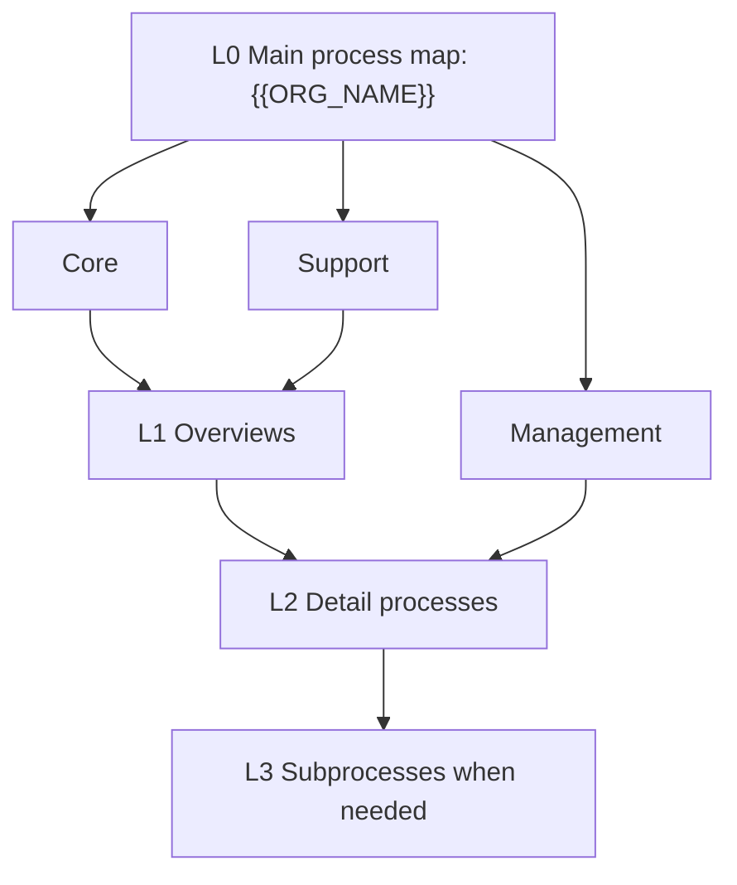

# Template — create a visual management system in 2c8 from documents

> **Reader:** AI agent with MCP server **modelM8**, filesystem and shell.  
> **Names:** **modelM8** = the MCP tool you call. **2c8** = Modeling Tool, repos, models and methodology (unchanged). Never say that the models “live in modelM8”.  
> **Origin:** Generated from `TechSeed-IMS/Create-2c8-IMS.md` + lessons learned (`TechSeed-IMS/_2c8-work/SLUTRAPPORT.md`, 2026-11-22) and modelM8 v1.2+ quality/write tools.  
> **How to use this template:** Copy to the project folder (e.g. `<ORG>-IMS/Create-2c8-IMS.md`), fill in all `{{PLACEHOLDERS}}`, remove sections that do not apply, and let the agent run the plan.

---

## 0. Placeholders (fill in before running)

| Key | Example | Value in this project |
|---|---|---|
| `{{ORG_NAME}}` | TechSeed | |
| `{{REPO_NAME}}` | TechSeed IMS | |
| `{{SOURCE_DIR}}` | `TechSeed-IMS/` | |
| `{{WORK_DIR}}` | `TechSeed-IMS/_2c8-work/` | |
| `{{PROCESS_REGISTER}}` | REG-IMS-002 Process Register | |
| `{{GOVERNANCE_DOC}}` | DIR-IMS Governance & Oversight | |
| `{{PRIMARY_LOCALE}}` | `en_GB` / English | |
| `{{SECONDARY_LOCALE}}` | `sv_SE` / Swedish | |
| `{{PILOT_AREA}}` | Sales | |
| `{{DOC_BASE_URL}}` | SharePoint/`https` **or** leave empty and use `{{SOURCE_DIR}}` as `file://` document root | |
| `{{STANDARDS}}` | ISO 9001, 14001, (27001) | |

---

## 1. Mission

Transform `{{ORG_NAME}}`'s document-based management system (`{{STANDARDS}}`) into a **visual management system in 2c8 Modeling Tool**.

Top-down navigation:

1. **L0** main process map (management / core / support),
2. **L1** overview map per area (≥2 details),
3. **L2** detail processes (activities, RACI, BO in/out, IT, step-specific documents),
4. **L3** when needed (e.g. development phases).

**Done when:**

- The repo `{{REPO_NAME}}` exists and contains the structure.
- Every process in `{{PROCESS_REGISTER}}` has a model and is reachable from L0 via breakdowns (`get_navigation_tree` without unexpected `missingUpwardLinks`).
- Every model: `review_process_model` OK or a logged exception.
- Traceability source ↔ model complete; nothing invented without `ASSUMPTION` in `GAPS.md`.
- Handoff contract verified with `verify_handoffs` (same BO UUID).
- Translations: `list_untranslated_symbols` for the secondary language is empty (or exception logged).
- `verify_process_coverage` against the process register: `allPass`.

---

## 2. Parameters — confirm before first write

| Parameter | Default | Comment |
|---|---|---|
| `TARGET_REPO` | New repo **`{{REPO_NAME}}`** | Created in phase 2. Never write to other repos. |
| `PRIMARY_LANGUAGE` | `{{PRIMARY_LOCALE}}` (repo default) | Process/activity/BO titles. |
| `SECONDARY_LANGUAGE` | `{{SECONDARY_LOCALE}}` | Translate **in the same batch** as primary when the symbol is created (do not save for the end). |
| `ROLE_AND_SYSTEM_NAMES` | Keep source names | If the source is in a different language than process titles. |
| `UNREGISTERED_PRACTICES` | Model + log in GAPS | Practices without a row in the process register. |
| `SCOPE_OPTIONAL_AREAS` | Chevron + document | Areas without certification / unfinished material. |
| `DOC_BASE_URL` | `{{DOC_BASE_URL}}` or `{{SOURCE_DIR}}` | Shared base → **always** `create_document_root` before folder/practice links. Empty does **not** mean “skip root”: use `SOURCE_DIR` (filesystem → `file:///…/`). `link_document(documentRootKey, relativePath, titles for all languages)` stores **full absolute URLs per language** (API `prefix` is not a root FK). After mass create: **human** matches paths to the root in the 2c8 UI. Never bare relative paths. Content/URL is language-specific like titles. |
| `PILOT_AREA` | `{{PILOT_AREA}}` | First vertical slice. |
| `STOP_AFTER_PILOT` | Yes | Stop after G3 / client OK. |
| `WORK_DIR` | `{{WORK_DIR}}` | STATE, GAPS, cards, extract, … |

If confirmation is missing: **one** consolidated question. Languages must be settled before `create_repository`.

---

## 3. Rules that always apply

1. The **modelM8** server **instructions** take precedence over this plan.
2. **Source fidelity** — do not invent; assumptions → `GAPS.md` type `ASSUMPTION`.
3. **Reuse-first** only within the target repo. Never copy UUIDs across repos.
4. Never change the source documents.
5. No duplicates — `find_models` / `search_symbols` before creating. Failed model: **repair** the existing model (`move_canvas_vertices`, `delete_canvas_edge`, `update_canvas_edges`, …). Do **not** create a second model with the same title. Use `ZZ_UTGÅR – …` only when repair is inappropriate; record both IDs in STATE (deletion requires `TWO_C8_ALLOW_DELETES`).
6. No model is done without `review_process_model`. For overviews, review **with** `detailModelIds`. **Green review ≠ source fidelity** — see §10.4.
7. **Handoff = same UUID**, never “similar title”.
8. **Vägval draws the choice; the activity does the work.** Pattern: `activity → BO → or → next activity`. Never Join/gateway. Call `resolve_branching_object_type`.
9. Process-wide documents on the **process symbol**, not fan-out onto every activity.
10. `link_breakdown` **immediately** after every non-root model — do not wait for final checks.
11. **Stop rules (hard):**
    - Same tool + same error class **×3** → stop **all** tool calls; ask the user. No “one more try”, guessed args, or other repositories.
    - User correction (“stop”, “MCP only”, “do not read code”, …) → stop immediately; no further exploratory calls.
    - Write-scope / deny errors → stop; do not unlock or switch repos.
    - Also stop and ask on: unconfirmed parameters, completed pilot, structure-affecting contradiction, destructive action.
12. **STATE is binding.** Copy `templates/STATE.md` → `WORK_DIR/STATE.md` in phase 0. Update after **every lasting write**. A phase may be marked `complete` only when its **Gate evidence** block is filled. Do not start phase *n+1* without gate *n* evidence.
13. **Write scope:** after repo create / before writes, `get_write_scope` must show locked to the target `repositoryId`. Never write to other repos.

---

## 4. Environment and tools (modelM8 ≥ 1.2)

All tool names below are invoked via the MCP server **modelM8**. Results are written to / read from **2c8**.

### 4.1 Verify at start

Confirm that modelM8 is connected. Run `list_repositories`, `get_api_versions`; check write mode (`direct`/`draft`), that `create_repository` exists, that `delete_model` is absent if deletes are off. When writes are enabled: `get_write_scope` — lock to target before mutating calls (`lock_write_repository` or auto-lock via `create_repository`).

### 4.2 Tool map (selection)

| Purpose | Tools |
|---|---|
| Orientation | `list_repositories`, `list_languages`, `list_description_types`, `list_document_types`, `list_allowed_types` (at most 1×) |
| Write scope | `get_write_scope`, `lock_write_repository`, `unlock_write_repository` (operator unlock only) |
| Methodology | `get_methodology`, `resolve_branching_object_type`, `validate_against_methodology` |
| Consume | `find_models`, `describe_process`, `describe_process_map`, `get_detail_process_scope`, `search_symbols`, `find_symbol_usage`, `describe_role` |
| Propose/write | `propose_model_from_text`, `apply_model_proposal`, `create_process_model`, `create_process_map`, `add_process_step`, `reuse_symbol`, `set_activity_performer`, `set_step_io`, `link_breakdown`, `link_document`, `create_document_type`, `create_document_root`, `update_titles`, `update_model_description`, `update_symbol_description` |
| Fix layout | `delete_canvas_edge`, `move_canvas_vertices` (auto-reortho), `update_canvas_edges`, `delete_canvas_vertex`, `retarget_vertex_symbol` |
| Quality (v1.2+) | `review_process_model`, `list_untranslated_symbols`, `verify_handoffs`, `get_navigation_tree`, `verify_process_coverage`, `verify_document_links` |

### 4.3 Known limitations

| # | Limitation | Handling |
|---|---|---|
| 1 | `review_process_model` assumes a horizontal spine | L0 three bands / parallelTracks → approved exceptions (10.3) |
| 2 | `create_process_map` builds linear/parallel chains, not a free multi-row map | First area overview **manual template**; auto-map only when scopes share UUIDs |
| 3 | Breakdowns live on the **detail** (`broken-down-from`); overview often returns empty/404 | Use `get_navigation_tree`, not `get_breakdowns(L0)` |
| 4 | New repo may lack description/document types until the client has been opened | Smoke test in phase 2; `create_document_type` as needed |
| 5 | MT documents require `type: URL\|file` + link via `{id, source:"mt.documents"}` | See `link_document`; test on a dummy before mass linking |
| 6 | Empty HTTP 200 on PATCH = OK (`{ok:true}`) | Do not interpret as an error |
| 7 | Join is sometimes mentioned in older methodology text | Follow `resolve_branching_object_type` / policy: never Join |
| 8 | EMF/Visio images in source are hard to Q2 | Require PNG/SVG in extract or convert in phase 0 |

Log modelM8/API deviations in `WORK_DIR/MCP-FEEDBACK.md`.

---

## 5. Source material

### 5.1 Inventory

Map `{{SOURCE_DIR}}`: document hierarchy (policy → directive → practice → register → record), ID format, language, archive vs active.

### 5.2 Process register

Table from `{{PROCESS_REGISTER}}`: code, title, category (management/core/support), owner, governing practice. This becomes `expected[]` for `verify_process_coverage`.

### 5.3 Governing documents

List policies/directives/practices that should become MT documents and be linked to process symbols.

### 5.4 Gaps

Start `GAPS.md` with ID contradictions, missing files, unregistered practices, scope conflicts. Do **not** fix the source.

---

## 6. Target structure

### 6.1 Levels



- Area with **one** detail: no L1 — L0 breaks down directly.
- Navigation = `link_breakdown` (same process symbol UUID on the upper map).

### 6.2 L0 design

- Core band (middle): BO → process → BO … with the **same** UUIDs as the details' primary I/O.
- Management (above) and support (below): chevrons without FLOW = approved L0 exception for `process-missing-input-bo`.
- Build L0 manually (`create_process_model` + `reuse_symbol` / `add_process_step` + `set_step_io` + `link_breakdown`). Alternative: early stub + re-link in phase 5.

### 6.3 Model inventory

Fill table: `ID | Level | Title | Source document/section`. Guideline 4–9 activities per detail.

### 6.4 Handoff contract (create **before** text-to-model)

| Handoff | Canonical BO title | Producer model | Consumer model | symbolId (filled in phase 1b) |
|---|---|---|---|---|
| … | … | … | … | |

Create/reuse UUID before detail cards are locked. Verify later with `verify_handoffs`.

---

## 7. Modelling conventions

- **Names:** infinitive + noun (process/activity). BO = value/artefact, not a status echo of the activity.
- **Performer:** `RACI_RESPONSIBLE` per activity (`set_activity_performer`). Role under each activity — not one vertex to many.
- **Documents:** CONTROLS / IS_USED_BY step-specific; process-wide on the process symbol.
- **Document roots:** shared base → `create_document_root`; links store full absolute URLs (`documentRootKey` + `relativePath` joins root.value). User matches roots in 2c8 UI after create (API `prefix` ≠ root FK).
- **`usedByTypes`:** templates/registers = `core_document`; systems = `application` (fix English “Template” before apply).
- **Layout:** left→right, FLOW in left / out right; multi-IO stacked under primary (same X); vägval No below the spine.
- **Descriptions (activity):** complement the canvas — do not repeat RACI, control/support documents or BO in/out. Short purpose/why + important considerations **only** if present in source material (`update_symbol_description`; see `get_methodology` topic `activity` → `descriptionGuidance`). Do not invent. Model/process description: purpose, scope, owner, source, metrics, ISO clause where source material exists.
- **Translation:** `update_titles` with `titles: { primaryId, secondaryId }` in the same call when possible.

---

## 8. Work plan

### Phase 0 — Preparation (no writes)

1. Read modelM8 instructions + tool schemas; verify environment.
2. `get_methodology` (process, process-map, **activity**, naming, business-objects, documents-on-process, document-roots, breakdowns, gateways) — especially read `activity.descriptionGuidance`; `resolve_branching_object_type("vägval")`.
3. Extract sources → `WORK_DIR/extract/` (incl. image conversion if EMF).
4. Create work files (section 11); seed `GAPS.md`.
5. Confirm parameters.

**G0 (binding evidence in STATE):** parameters confirmed by user; extract exists; methodology read; `list_repositories` checked. Do not start phase 1 writes planning as “done” without this block filled.

### Phase 1 — Analysis and design (no writes)

1. Read process register, roles, governance, clause log.
2. Process card per candidate model in `cards/<ID>.md` (for pilot-only runs: all pilot cards as a minimum).
3. `CATALOG.md`: roles, systems, documents, shared BOs.
4. **Document roots (propose in the plan):** inventory shared bases. If `DOC_BASE_URL` is set, use it; if empty, default proposed root `value` = absolute path to `{{SOURCE_DIR}}` (MCP normalizes to `file:///…/`). Write proposed roots in `CATALOG.md` / STATE: `key`, proposed `value`, title, which documents/areas are covered. Do **not** create them until phase 2. Do **not** plan bare relative links.
5. Align inventory; design check (in/out/responsible/name).

**G1 (binding):** cards + catalog + SOURCE-MAP skeleton + proposed document roots complete **and** recorded in STATE Gate evidence. Do not open phase 2 until G1 evidence is filled.

### Phase 1b — Handoff contract (no model writes; preferably symbol UUIDs after phase 2)

1. Complete table 6.4.
2. After the repo exists: `search_symbols` / create canonical handoff BOs; save UUIDs in the contract.
3. Lock canonical titles in `CATALOG.md` (alias → canon, e.g. HRM → HR system).

### Phase 2 — Create repo `{{REPO_NAME}}`

1. `list_repositories` — does the name already exist? (repos often cannot be deleted).
2. `create_repository` with languages (primary default + secondary).
3. `list_languages`, `list_description_types`, `list_document_types`, `list_document_roots`.
4. If document type missing: `create_document_type`.
5. **Document roots:** create proposed roots with `create_document_root` (`key` + `value`). If `DOC_BASE_URL` was empty, still create a root whose `value` is `{{SOURCE_DIR}}` (or the inventoried library folder). Verify with `list_document_roots`.
6. **Smoke test (mandatory — do not defer):** minimal path does **not** require a finished process model. Create root + types → attach `link_document` on a disposable/dummy symbol to a known file under `SOURCE_DIR` → `titles` for **all** languages (same absolute URL) → `verify_document_links` **without** `languageId` must `allPass`. **Forbidden:** skipping smoke “until the pilot model exists”. Note in STATE: after mass linking, user runs 2c8 UI “match document roots”. Never bare relative `createDocumentBody.content`.
7. `find_models` = 0 (or reconciled against STATE on resume).
8. Confirm `get_write_scope` locked to the new `repositoryId`.

**G2 (binding):** `repositoryId` + language IDs + document-root `key` + smoke + `verify_document_links` in STATE Gate evidence. Do not start phase 3 without G2 complete.

### Phase 3 — Pilot `{{PILOT_AREA}}`

1. **Details first** per recipe 9.1 (incl. secondary language in the same `update_titles` batch, `link_breakdown` immediately). Fetch `get_detail_process_scope` for each detail → STATE.
2. **Only then** area map (recipe 9.2). Never create L1 before its L2 details exist. Never a second overview with the same title — repair instead.
3. `verify_handoffs` for the pilot's rows in 6.4; `list_untranslated_symbols`; source-fidelity checklist §10.4.
4. Q1–Q3; **client OK** (open in Modeling Tool: document panel, language, breakdown click).

**G3 — stop.** Report with evidence; continue after go-ahead.

### Phase 4 — Area by area

Order: (adapt) core → support → management (PDCA) → optional scope areas.

Per area: details → map → Q1–Q3 → `list_untranslated_symbols` → `verify_handoffs` (area rows) → STATE.  
Serial across areas when handoffs cross; parallelize only *within* an area with a shared CATALOG.

### Phase 5 — L0 and navigation

Build/complete L0; `link_breakdown` for all chevrons; `get_navigation_tree(rootModelId)`; `review_process_model` with L0 exceptions.

### Phase 6 — Consolidation (not “start translating”)

1. `verify_handoffs` on all of 6.4.
2. Duplicates / aliases → `retarget_vertex_symbol` or reuse.
3. `list_untranslated_symbols` (secondary vs primary).
4. Role spot-check `describe_role`.
5. Document panels / `get_object_documents`.

### Phase 7 — Final check

Q4–Q5 + final report (section 12).

---

## 9. Standard recipes

### 9.1 Detail process

| Step | Action | Check |
|---|---|---|
| 1 | `find_models` | No duplicate |
| 2 | `search_symbols` (roles, systems, BO, documents) | Note UUID; handoff BO from 6.4 |
| 3 | Prefixed text → `propose_model_from_text` | |
| 4 | Review proposal | BO↔activity; namingChecks; `or`; performers; usedByTypes |
| 5 | `apply_model_proposal` | `businessObjectCount > 0` |
| 6 | `describe_process` vs card | |
| 7 | `review_process_model` → fix → again | 0 errors / logged exception |
| 8 | `get_detail_process_scope` → STATE | |
| 9 | `link_breakdown` to parent **now** | |
| 10 | Activity descriptions: `update_symbol_description` **only** where source material provides purpose/why/considerations — complement the canvas, do not repeat RACI/documents/BO (`get_methodology` → `activity.descriptionGuidance`). Empty > guesswork. | |
| 11 | Model description (`update_model_description`) + `link_document` where source material exists | |
| 12 | `update_titles` (primary + secondary) | |
| 13 | STATE status | |

Layout fix: `move_canvas_vertices` (reortho default); symbol swap: `retarget_vertex_symbol`.

### 9.2 Overview map

**Order is mandatory:** L2 details → `get_detail_process_scope` each → then L1.

1. `find_models` — if an overview with the same title exists, **repair it**; do not create another.
2. All details done + scope fetched and stored in STATE.
3. Choose form: chain / `parallelTracks` / `sideLoops` / manual rows (peer variants → `parallelTracks`, not a false linear chain).
4. Fix handoffs in details first — no overview-only BOs.
5. Prefer `create_process_map({ detailModelIds })` when scopes share UUIDs; otherwise manual template.
6. `describe_process_map(detailModelIds)` → `scopeOk`; `review_process_model` **with** `detailModelIds` (review without details is insufficient); `get_navigation_tree` / breakdowns on details.

---

## 10. Quality assurance

| Gate | When | Requirement |
|---|---|---|
| **Q1** | Every model | `review_process_model` 0 errors / exception; overviews **with** `detailModelIds` |
| **Q2** | Detail | **Spot-check + risk-based** (new areas, vägval, handoffs). Activity descriptions: if source material exists → filled per `descriptionGuidance`; if no source material → empty (not invented). Full line-by-line only if budgeted. |
| **Q3** | Area | scopeOk; breakdowns; `list_untranslated_symbols` empty; handoffs for the area; **`verify_document_links`** (all languages) `allPass` after area `link_document`; §10.4 checklist |
| **Q4** | Phase 7 | `get_navigation_tree` + `verify_process_coverage` + `verify_handoffs` (all of 6.4) + **`verify_document_links`** (whole repo, all languages) |
| **Q5** | Phase 7 | SOURCE-MAP complete |

### 10.3 Approved exceptions (log)

- L0 management/support without FLOW → `process-missing-input-bo`
- Intentional multi-IO stacking / parallelTracks layout findings if the same row is aligned

### 10.4 Source-fidelity checklist (green review is not enough)

Before marking a model/area OK, complete and note in STATE what was **not** verified:

1. Steps vs source practice (no silent omissions / inventions).
2. Activity-specific RACI — do not assign the same role everywhere just to pass review.
3. Vägval / Go-No-Go vs source (objectType `or`, real next activities).
4. Documents on the right level (process vs step CONTROLS / IS_USED_BY).
5. Overview I/O UUID = detail primary I/O (`describe_process_map` / scope).
6. Assumptions only in `GAPS.md`; pending consumers explicit for handoffs.

### Client gate (explicit)

Before closing pilot/area: open model in 2c8 MT — document panel, secondary language, breakdown click.

---

## 11. Work files

| File | Contents |
|---|---|
| `STATE.md` | Copy from `templates/STATE.md` — gate evidence, parameters, model table, verify results, incident log |
| `GAPS.md` | CONTRADICTION / GAP / ASSUMPTION / QUESTION / DECISION |
| `SOURCE-MAP.md` | Document section → model / status |
| `CATALOG.md` | Roles, systems, documents, handoff BO (+ UUID), proposed document roots (`key`/`value`) |
| `MCP-FEEDBACK.md` | modelM8/API errors with request/response |
| `cards/<ID>.md` | Process card |
| `extract/` | Extracted text/images |
| `SLUTRAPPORT.md` | Phase 7 |

**Resume:** read STATE (gate evidence + models + incidents) → `get_write_scope` → `find_models` / `get_navigation_tree` before continued writing.  
**Incidents:** log failed out-of-scope write attempts in STATE even when the API returned an error.

---

## 12. Final report

- Repo + `repositoryId`, number of models/level, symbols per type.
- Navigation tree (from `get_navigation_tree`).
- Coverage (`verify_process_coverage`), handoffs, translation status.
- Review + exceptions; GAPS and MCP-FEEDBACK summary.
- What is not done — say it straight.

---

## 13. Recommended order (compressed)

1. Extract + GAPS + CATALOG  
2. Handoff contract (titles → UUID after repo)  
3. Create repo + smoke (document type, link_document, description)  
4. Pilot → client OK  
5. Per area: card → propose/apply → review → activity descriptions (source-based) + EN+docs → **breakdown** → handoff-verify → STATE  
6. L0 (stub early or last)  
7. Consolidation = handoff + duplicates + untranslated + coverage — not “start translating”  
8. Q4/Q5 + final report  

---

## Appendix A — Extraction

Reuse or adapt the extraction script from the project's existing plan (docx/pdf/xlsx/pptx → `extract/`). Skip boilerplate texts and this plan file.

## Appendix B — Prefixed text (example)

```
Process: Registrera order
Input: Kundbehov
Aktivitet: Ta emot förfrågan — ansvarig: Säljare — används: CRM
Output: Registrerad förfrågan
Aktivitet: Kvalificera lead — ansvarig: Säljare
Vägval: Är leaden kvalificerad?
Ja: Output: Kvalificerad möjlighet
Aktivitet: Ta fram offert — ansvarig: Säljare — styrdokument: Offertrutin
Nej: Output: Avvisad förfrågan
Output: Överlämningspaket
```

## Appendix C — Common errors → action

| Symptom | Action |
|---|---|
| `businessObjectCount = 0` | Fix proposal chain BO↔activity; apply again |
| activity→activity / BO→BO | `delete_canvas_edge` + `set_step_io` |
| Missing performer | `set_activity_performer` |
| EN == SV with åäö | `list_untranslated_symbols` → `update_titles` |
| Alias system on canvas | `retarget_vertex_symbol` |
| Overview without children | `link_breakdown` + `get_navigation_tree` |
| Document type must be provided | `type: URL\|file` + possibly `create_document_type` |
| 400 after move | `move_canvas_vertices` with default reortho |

---

*Template version: 2026-11-22 · modelM8 1.2+ (2c8 Modeling Tool)*
